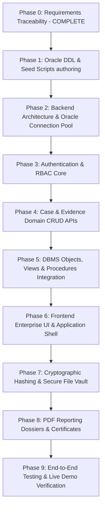

# DFEMS — REQUIREMENTS TRACEABILITY & VERIFICATION CHECKLIST

> **Status:** Discovery & Requirements Analysis Complete  
> **Target System:** Digital Forensic Evidence Management System (DFEMS)  
> **Database Platform:** Oracle Database 26ai Free (`FREEPDB1` Pluggable Database)  
> **Database Account:** `dfems_user`  
> **Driver & Language:** Node.js `oracledb` Driver, pure Oracle SQL & PL/SQL  
> **Source Documents Analyzed:**  
> 1. `Requirements/DA1.pdf` (34 pages: Problem Statement, Research Gaps, 6 Modules, FR1–FR12, NFR1–NFR9, EER Diagram, Data Dictionary, Normalization up to BCNF)  
> 2. `Requirements/DBMS DIGITAL ASSIGNMENT 2(25BRS1220).docx` (54 verified SQL execution artifacts: 12 Tables, Constraints, Seed Data, CRUD, Joins A1–A4, Nested Queries B1–B4, Aggregate Queries C1–C4, 3 Views, 4 Stored Procedures, 2 Functions, 3 Triggers, Transactions)  
> 3. `MASTER_PROJECT_SPEC.md` (28 Mandatory Project Requirements, Enterprise UI/UX Tokens, Live-Demonstration Criteria)  
> 4. `REQUIREMENTS_TRACEABILITY.md` (Complete architectural specification and dialect mapping)

---

## 1. Document Accessibility & Readiness Confirmation

| Document Path | Format & Size | Accessibility Status | Key Contents Verified |
|---|---|---|---|
| `Requirements/DA1.pdf` | PDF (761 KB, 34 Pages) | **Confirmed Accessible & Readable** | Full problem statement, 6 modules, 6 stakeholder roles, FR1–FR12, NFR1–NFR9, EER diagram, 12 relations, BCNF normalization proofs. |
| `Requirements/DBMS DIGITAL ASSIGNMENT 2(25BRS1220).docx` | DOCX (4.5 MB, 54 Images) | **Confirmed Accessible & Readable** | Complete SQL DDL/DML, 12 tables, 15 evidence records, 33 custody entries, views (`v_custody_trail`, `v_case_summary`, `v_evidence_full`), stored procedures (`sp_register_evidence`, `sp_add_analysis`, `sp_flag_stale_evidence`, `sp_transfer_custody`), functions (`fn_days_in_current_status`, `fn_verify_hash`), triggers (`trg_evidence_status_change`, `trg_custody_no_update`, `trg_custody_no_delete`), transaction savepoints. |
| `MASTER_PROJECT_SPEC.md` | Markdown (14.3 KB, 267 Lines) | **Confirmed Accessible & Readable** | Master specification with 28 project requirements, design tokens, architecture guidelines, live demonstration criteria, definition of done. |

---

## 2. Gap, Conflict & Reconciliation Analysis

An exhaustive comparison between `DA1.pdf`, `DA2.docx`, and `MASTER_PROJECT_SPEC.md` revealed key structural gaps and schema nuances. All reconciliation follows the **Database Preservation Principle**: existing tables, columns, rows, constraints, triggers, and procedures must remain 100% operational without regression.

### Conflict 1: Authentication & User Credentials (`APP_USER`)
* **DA1 Requirement:** FR7, RBAC Module, and Data Dictionary specify user accounts with `User_ID`, `Username`, `Password (hashed)`, `Role`, and `Status`. Roles include: *Admin*, *Investigator*, *Forensic Examiner*, *Evidence Custodian*, *Legal/Court Reviewer*, *Auditor*.
* **DA2 Implementation:** `APP_USER` only contains `User_ID`, `First_Name`, `Last_Name`, and `Phone_Number`. There are no columns for username, password hash, role, or account status.
* **Master Spec:** Requirement 4 & 5 mandate working authentication and RBAC with secure bcrypt hashing.
* **Reconciliation Strategy:** Define `APP_USER` in Oracle 26ai (`dfems_user`) with:
  - `Username VARCHAR2(50 CHAR) UNIQUE`
  - `Password_Hash VARCHAR2(255 CHAR)`
  - `Role VARCHAR2(30 CHAR) DEFAULT 'Investigator' NOT NULL` with `CHECK (Role IN ('Admin', 'Investigator', 'Forensic Examiner', 'Evidence Custodian', 'Legal Reviewer', 'Auditor'))`
  - `Account_Status VARCHAR2(20 CHAR) DEFAULT 'Active' NOT NULL` with `CHECK (Account_Status IN ('Active', 'Suspended', 'Inactive'))`
  - Existing DA2 seed users (Ravi Kumar, Ananya Rao, etc.) receive deterministic usernames and hashed default passwords, preserving all existing IDs and foreign key links.

### Conflict 2: Audit Logging vs. Custody Logging
* **DA1 Requirement:** Distinguishes between evidence chain of custody and general audit logging (login attempts, failed logins, sensitive record reads, administrative updates).
* **DA2 Implementation:** Contains `CHAIN_OF_CUSTODY (Custody_ID, Timestamp_At, Action, Evidence_ID)`. Has no general system `AUDIT_LOG` table.
* **Master Spec:** Requirement 16 mandates audit logging and specifically instructs preventing duplicate log entries between application logic and database triggers.
* **Reconciliation Strategy:** 
  1. Add a dedicated `AUDIT_LOG` table (`Log_ID`, `User_ID`, `Action`, `Entity_Name`, `Entity_ID`, `IP_Address`, `Timestamp_At`, `Details`) for authentication and administrative telemetry.
  2. For `CHAIN_OF_CUSTODY`, keep the DA2 schema intact. Note that `trg_evidence_status_change` automatically records custody updates when `EVIDENCE.Status` is changed. The backend application will avoid manually inserting duplicate custody entries for status transitions already handled by the database trigger.

### Conflict 3: Evidence Files vs. Physical Metadata
* **DA1 Requirement:** FR1 & FR2 specify evidence registration, file upload, SHA-256 hash generation, and storage.
* **DA2 Implementation:** Distinguishes between `DEVICE` (`Device_ID`, `Serial_Number`, `Evidence_ID`) and `FILE_RECORD` (`File_ID`, `Evidence_ID`). However, `FILE_RECORD` in DA2 has no columns for original file name, disk storage path, file size, or MIME type.
* **Master Spec:** Requirement 10 & 11 mandate real file uploads, local storage, SHA-256 computation on intake, and cryptographic re-verification.
* **Reconciliation Strategy:** Include physical storage columns in `FILE_RECORD`:
  - `File_Name VARCHAR2(255 CHAR)`
  - `File_Path VARCHAR2(500 CHAR)`
  - `File_Size NUMBER`
  - `Mime_Type VARCHAR2(100 CHAR)`
  Existing seed rows remain valid with `NULL` paths, while newly uploaded evidence files store physical file references.

### Conflict 4: Additional Case Attributes (Suspects, Victims, Crime Type)
* **DA1 Requirement:** FR5 and Data Dictionary mention case metadata (Crime Type, Date Opened) and linkages to Suspects and Victims.
* **DA2 Implementation:** `CASE_TABLE` has `Case_ID`, `Title`, `Status`, `Created_By`, `Assigned_To`, `Location_ID`. No dedicated suspect/victim tables exist in DA2's 12 tables.
* **Reconciliation Strategy:** 
  - Add optional columns `Crime_Type VARCHAR2(100 CHAR)` and `Date_Opened DATE DEFAULT SYSDATE` to `CASE_TABLE`.
  - Case suspect and victim information will be supported via structured metadata on `CASE_TABLE` without interfering with DA2 queries.

### Conflict 5: Column Naming Consistency (`Timestamp` vs `Timestamp_At`)
* **DA1:** Mentions `Timestamp` in the Data Dictionary.
* **DA2:** Specifically implemented as `Timestamp_At` in MySQL (`CHAIN_OF_CUSTODY.Timestamp_At`).
* **Reconciliation Strategy:** Strictly adhere to DA2's verified column `Timestamp_At`. All Oracle SQL queries, views, procedures, and backend mappings use `Timestamp_At`.

---

## 3. The 28 Master Requirements Traceability Matrix

| # | Master Requirement | DA1 Ref | DA2 Ref | Oracle Database Objects (`dfems_user`) | API Endpoints (`oracledb`) | Frontend UI/UX Component | Verification & Live-Demo Test | Status |
|---|---|---|---|---|---|---|---|---|
| **1** | **Requirements Traceability** | Sec. 1–5, FR1–FR12 | Complete DA2 Spec | All 12 tables + `AUDIT_LOG` in `dfems_user` | `GET /api/system/traceability` | Checklist viewer & docs | Traceability matrices tracking all 28 items | **COMPLETE** |
| **2** | **Professional Application Architecture** | Sec. 3, Proposed Architecture | Full-stack scope | `FREEPDB1` connection pool | `/api/cases`, `/api/evidence`, `/api/custody`, etc. | Modern React + Vite modular tree (components, hooks, pages, services) | Code audit, clean folder layout, layered backend (controllers, services, middleware) | **PLANNED** |
| **3** | **Professional UI/UX** | NFR7 (Usability) | DA2 UI requirements | Central design tokens | Static assets & API styling | Enterprise design tokens (`#172033`, `#356AE6`, Inter font, sidebar shell, badges) | Responsive layout testing (Desktop, Tablet, Mobile) without visual glitches | **PLANNED** |
| **4** | **Authentication** | FR7, NFR2 | `APP_USER` extension | `APP_USER` (`Username`, `Password_Hash`, `Account_Status`) | `POST /api/auth/login` `POST /api/auth/logout` `GET /api/auth/me` | Login page, secure session/token store, User Menu, Protected Routes | Test login with valid/invalid credentials, password hashing via bcrypt | **PLANNED** |
| **5** | **Role-Based Access Control (RBAC)** | FR6, System Roles (Admin, Inv, Analyst, Custodian, Legal, Auditor) | `APP_USER`, `INVESTIGATOR`, `FORENSIC_ANALYST` | `APP_USER.Role`, permission mapping | Role enforcement middleware on all `/api/*` endpoints | Scoped UI views, action buttons disabled/hidden for non-authorized roles | Attempt prohibited actions (e.g., investigator trying to delete; auditor trying to edit) | **PLANNED** |
| **6** | **Database Connectivity** | Sec. 2 (Oracle) | `FREEPDB1` | Connection pool via `oracledb` | `GET /api/health` | System status banner & health indicator in topbar | Real database ping test, connection failure graceful degradation | **PLANNED** |
| **7** | **Evidence and Case CRUD** | FR1, FR5 | CRUD Operations (Images 13–14) | `CASE_TABLE`, `EVIDENCE`, `DEVICE`, `FILE_RECORD` | `POST /api/cases` `PUT /api/cases/:id` `POST /api/evidence` `DELETE /api/evidence/:id` | Case/Evidence edit modals, data tables with row actions | Create case, update status, soft-delete/delete checks persisted in Oracle | **PLANNED** |
| **8** | **Case Management** | FR5, Objective 1 | `CASE_TABLE`, `ASSIGNED`, `LOCATION` | `CASE_TABLE`, `ASSIGNED`, `LOCATION` | `GET /api/cases` `GET /api/cases/:id` `POST /api/cases/:id/assign` | Case list, Case detail page, multi-investigator assignment chips | Create new case, assign investigators, verify junction table `ASSIGNED` | **PLANNED** |
| **9** | **Evidence Registration** | FR1, Objective 1 | `sp_register_evidence` (Image 32) | `EVIDENCE`, `sp_register_evidence` | `POST /api/evidence/register` | Evidence registration wizard (Device or File metadata) | Call `sp_register_evidence`, check new row in `EVIDENCE` and `CHAIN_OF_CUSTODY` | **PLANNED** |
| **10** | **Evidence File Handling** | FR1, NFR2 | `FILE_RECORD` (Image 4, 10) | `FILE_RECORD` (extended with path, size, MIME) | `POST /api/evidence/upload` `GET /api/evidence/:id/download` | Drag-and-drop file uploader, file preview, download button | Upload sample file, verify stored in secure upload directory, download file | **PLANNED** |
| **11** | **Evidence Integrity & Hashing** | FR2, FR3, Objective 3, NFR5 | `fn_verify_hash` (Images 37, 38, 54) | `EVIDENCE.Hash_Value`, `fn_verify_hash` | `POST /api/evidence/:id/verify-hash` | Integrity check badge, SHA-256 hash comparison modal | Test matching file hash (`MATCH`), test tampered file (`MISMATCH - POSSIBLE TAMPERING`) | **PLANNED** |
| **12** | **Chain of Custody** | FR4, Objective 2, NFR6 | `CHAIN_OF_CUSTODY`, `v_custody_trail` | `CHAIN_OF_CUSTODY`, `trg_custody_no_update`, `trg_custody_no_delete` | `GET /api/custody/evidence/:id` `POST /api/custody/transfer` | Chronological interactive custody timeline, immutable status pill | View custody history for evidence #1, attempt custody record modification (fails) | **PLANNED** |
| **13** | **Forensic Analysis** | FR8, Use Case Diagram | `FORENSIC_ANALYSIS`, `sp_add_analysis` | `FORENSIC_ANALYSIS`, `FORENSIC_ANALYST`, `sp_add_analysis` | `GET /api/analysis/evidence/:id` `POST /api/analysis` | Analysis findings editor, analyst certification badge | Add findings via `sp_add_analysis`, verify evidence status shifts to 'Under Analysis' | **PLANNED** |
| **14** | **Evidence Lifecycle** | FR8, Objective 1 | `chk_evidence_status`, `sp_flag_stale_evidence` | `EVIDENCE.Status`, `fn_days_in_current_status` | `GET /api/evidence/stale` `PUT /api/evidence/:id/status` | Lifecycle stage stepper (Collected → In Storage → Under Analysis → Court → Archived) | Run stale evidence check, transition evidence status, verify trigger update | **PLANNED** |
| **15** | **Search and Filtering** | FR9, NFR1 | SQL Queries (Images 17–19) | Indexed search on Case ID, Status, Type, Date | `GET /api/evidence/search?q=...` | Unified search bar, multi-filter dropdowns, pagination controls | Search evidence by keyword, status filter, verify sub-second response | **PLANNED** |
| **16** | **Audit Logging** | FR11, NFR6 | Triggers & Audit specs | `AUDIT_LOG` table, `trg_evidence_status_change` | `GET /api/audit-logs` | Filterable audit event viewer, user activity logs | Test login attempt logging, verify no duplicate custody events | **PLANNED** |
| **17** | **Input Validation and Integrity** | FR12, NFR5 | CHECK & FK Constraints | Table constraints (`chk_case_status`, `chk_evidence_status`, FKs) | Express request validation (Zod schemas) | Form input masks, inline error messages, toast alerts | Attempt invalid foreign key insertion, invalid status string; confirm rejection | **PLANNED** |
| **18** | **SQL CRUD Demonstration** | DA2 Sec. 4 | CRUD Images 13–14, 49–54 | Verified Oracle SQL scripts | Backoffice SQL console / query runner | SQL CRUD Demonstration tab with preloaded test queries | Execute `INSERT`, `SELECT`, `UPDATE`, `DELETE` scripts against `APP_USER` and `EVIDENCE` | **PLANNED** |
| **19** | **Joins Implementation** | DA2 Sec. 6 | Queries A1–A4 (Images 20–22) | Multi-table joins across 6 entities | `GET /api/reports/joins/:type` | Relational report views displaying linked data cards | Execute Queries A1, A2, A3, A4; display relational outputs in UI | **PLANNED** |
| **20** | **Nested Queries & Aggregate Functions** | DA2 Sec. 7 & 8 | Queries B1–B4, C1–C4 (Images 23–28) | Subqueries (`COUNT`, `AVG`, `SUM`, `GROUP BY`) | `GET /api/analytics/aggregates` | Statistical metrics widget, analytical charts | Execute Queries B1–B4 and C1–C4, compare against DA2 verified outputs | **PLANNED** |
| **21** | **Views Demonstration** | DA2 Sec. 9 | Views (Images 29–31, 52–53) | `v_custody_trail`, `v_case_summary`, `v_evidence_full` | `GET /api/views/custody-trail` `GET /api/views/case-summary` `GET /api/views/evidence-full` | Dedicated Views Explorer page with raw query toggle | Query all 3 views directly in Oracle and verify JSON payload in frontend | **PLANNED** |
| **22** | **Stored Procedures** | DA2 Sec. 10 | Procedures (Images 32–35, 39–40) | `sp_register_evidence`, `sp_add_analysis`, `sp_flag_stale_evidence` | `POST /api/procedures/register-evidence` `POST /api/procedures/add-analysis` `GET /api/procedures/stale-evidence` | Stored Procedure control panel with parameter inputs | Execute `CALL sp_register_evidence(...)`, `sp_flag_stale_evidence()` with cursor | **PLANNED** |
| **23** | **Database Functions** | DA2 Sec. 11 | Functions (Images 36–38, 54) | `fn_days_in_current_status`, `fn_verify_hash` | `GET /api/functions/days-in-status/:id` `POST /api/functions/verify-hash` | Interactive Hash Check calculator & Days-in-status badge | Execute `SELECT fn_days_in_current_status(1) FROM DUAL` and `SELECT fn_verify_hash(...) FROM DUAL` | **PLANNED** |
| **24** | **Triggers and Transactions** | DA2 Sec. 12 & 13 | Triggers (Images 41–43) & Transactions (44–48) | 3 Triggers + `sp_transfer_custody` (SAVEPOINT, COMMIT, ROLLBACK) | `POST /api/transactions/transfer-custody` `POST /api/transactions/test-rollback` | Trigger Audit Monitor & Transaction Test Playground | Test `trg_custody_no_delete` (raises ORA-20002), test rollback to SAVEPOINT | **PLANNED** |
| **25** | **Live-Data Dashboard** | DA1 Sec. 10, NFR1 | DA2 real dataset | Real-time counts from `dfems_user` | `GET /api/dashboard/stats` | KPI cards (Active Cases, Evidence Count, Custody Transfers, Stale Alerts) | Dashboard charts updating automatically from Oracle live state | **PLANNED** |
| **26** | **Reports and Visualizations** | FR10, Objective 5 | DA2 dataset | `v_case_summary`, `v_custody_trail` | `GET /api/reports/case/:id/pdf` `GET /api/reports/custody/:id/pdf` | PDF download buttons, print view, analytical charts | Generate and download court-ready PDF custody certificate and case dossier | **PLANNED** |
| **27** | **Testing and Error Handling** | NFR1–NFR9 | DA2 Sec. 14 (Images 49–54) | All database objects and validation rules | Full API test suite | Form validation feedback, HTTP error toast notifications | Automated test runner covering auth, CRUD, SQL queries, FK integrity; `TEST_REPORT.md` | **PLANNED** |
| **28** | **Live Demonstration and Documentation** | DA1 + DA2 Live Demo | Comprehensive Demo Guide | Preserved `dfems_user` data + demo scripts | All endpoints | Complete system presentation mode | Follow `LIVE_DEMO_GUIDE.md` step-by-step without code modification | **PLANNED** |

---

## 4. Live Demonstration Criteria Mapping

| Live Demo Section | Criteria & What Must Be Proven | Technical Artifact / Screen |
|---|---|---|
| **1. Application Shell & UI** | Responsive, polished enterprise theme; role indicator; sidebar navigation; consistent typography. | Main Dashboard, Case Explorer, Evidence Vault, Custody Trail. |
| **2. Real Database Connection** | Live connection to Oracle Database 26ai Free `FREEPDB1`, zero mock data, real-time query responses. | Topbar Database Health indicator, `/api/health` status check. |
| **3. Data Intake & CRUD** | Create case, assign investigators, register evidence, persist immediately in Oracle. | New Case Modal, Evidence Intake Form, SQL verification query. |
| **4. Permitted Updates & Deletion** | Update case status, update evidence metadata, demonstrate restricted deletion. | Evidence Edit Drawer, Confirmation Dialog, soft-delete or cascade check. |
| **5. Executable SQL CRUD** | Verified SQL statements executed directly in backoffice console or SQL*Plus client. | SQL Demonstration View preloaded with DA2 scripts. |
| **6. Joins, Nested & Aggregates** | Execute Queries A1–A4, B1–B4, C1–C4 live and show results matching DA2 screenshots. | Analytics & DBMS Query Playground with side-by-side SQL and data table. |
| **7. Views Inspection** | Query `v_custody_trail`, `v_case_summary`, and `v_evidence_full`. | Views Explorer tab with live execution against `FREEPDB1`. |
| **8. Stored Procedures & Cursors** | Call `sp_register_evidence`, `sp_add_analysis`, and `sp_flag_stale_evidence` (cursor loop). | Procedure Executor UI with parameter form and raw procedure output. |
| **9. Database Functions** | Execute `fn_verify_hash` and `fn_days_in_current_status`. | Hash Verification Tool showing live MATCH and MISMATCH. |
| **10. Triggers & Immutability** | Trigger auto-logging on status update; trigger rejection on attempt to delete custody. | Update evidence status -> show auto-logged custody record; attempt DELETE -> show ORA-20002. |
| **11. Transaction Savepoints** | Demonstrate `sp_transfer_custody` commit on success and rollback on simulated failure. | Transaction Workbench demonstrating `SAVEPOINT` and `ROLLBACK`. |
| **12. Security & RBAC** | Login as Admin vs Investigator vs Auditor; verify permissions enforced on backend. | Switch user role, verify prohibited action returns 403 Forbidden. |
| **13. PDF Reports** | Generate real court-ready PDF dossier for case summary and custody certificate. | "Export PDF" button -> instant formatted PDF download. |

---

## 5. Phased Implementation Sequence

