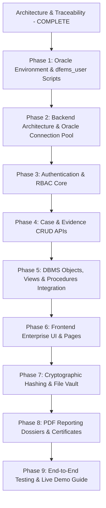

# DFEMS — COMPREHENSIVE REQUIREMENTS TRACEABILITY MATRIX & ARCHITECTURAL SPECIFICATION

> **System:** Digital Forensic Evidence Management System (DFEMS)  
> **Database Platform:** Oracle Database 26ai Free (`FREEPDB1` Pluggable Database)  
> **Database Schema/Account:** `dfems_user`  
> **Technology Stack:** React 18, Vite, JavaScript, Tailwind CSS, Lucide Icons, Recharts, Node.js, Express, `oracledb` (Node.js Oracle Database Driver), PDFKit, Zod  
> **Dialect & Procedural Language:** Oracle SQL & PL/SQL  
> **Author:** Senior Software Architect  
> **Date:** October 10, 2026  

---

## 1. Executive Summary & Environment Assessment

This document provides complete architectural traceability for DFEMS by unifying:
1. **DA1 Specification (`Requirements/DA1.pdf`):** Evidence lifecycle, 6 core modules, 6 stakeholder roles, 12 Functional Requirements (**FR1–FR12**), 9 Non-Functional Requirements (**NFR1–NFR9**), and BCNF relational design.
2. **DA2 Specification (`Requirements/DBMS DIGITAL ASSIGNMENT 2(25BRS1220).docx`):** 54 verified database artifacts, including 12 tables, 15 real-world evidence items, 33 custody entries, 12 specialized queries (Joins A1–A4, Nested Queries B1–B4, Aggregate Functions C1–C4), 3 Views, 4 Stored Procedures (including explicit CURSOR loop), 2 Database Functions, 3 Triggers, and Transaction Savepoints.
3. **Master Specification (`MASTER_PROJECT_SPEC.md`):** The 28 mandatory enterprise requirements, UI/UX design system tokens, live-demonstration rubric, and definition of done.

### Repository & Environment Inspection

| Item | Inspected State | Architectural Note |
|---|---|---|
| **Git Status** | Working tree clean on branch `main` (Commit `85abdd3`) | Existing commit history preserved; no untracked clutter. |
| **Project Workspace** | `d:\DEFMS` containing `Requirements/` and markdown specifications | No application source code or build artifacts present yet. |
| **Oracle Database 26ai** | Executable verified: `C:\app\Krishna\product\26ai\dbhomeFree\bin\sqlplus.exe`<br>Services: `OracleServiceFREE` (Running), `OracleOraDB23Home1TNSListener` (Running) | Database instance active with pluggable database `FREEPDB1`. |
| **Target Database User** | `dfems_user` in service `FREEPDB1` | Dedicated application user namespace with full object ownership. |
| **Driver & Language** | Node.js `oracledb` in Thin/Thick mode, pure Oracle PL/SQL | Eliminates MySQL dependencies (`mysql2`, delimiter directives, backticks). |

---

## 2. Requirement Count & Unified Taxonomy

DFEMS encompasses **110 atomic specification items** grouped under **28 Master Requirements**:

```
┌────────────────────────────────────────────────────────────────────────┐
│                        DFEMS REQUIREMENT INVENTORY                     │
├────────────────────────────────────────────────────────────────────────┤
│ 1. DA1 Functional Requirements (FR1 – FR12)                   :  12    │
│ 2. DA1 Non-Functional Requirements (NFR1 – NFR9)              :   9    │
│ 3. DA1 System Modules & Objectives                            :  11    │
│ 4. DA1 Stakeholder Roles (Admin, Inv, Analyst, etc.)          :   6    │
│ 5. DA2 Core Relational Tables                                 :  12    │
│ 6. DA2 Analytical Queries (Joins 4, Nested 4, Aggregates 4)   :  12    │
│ 7. DA2 Views                                                  :   3    │
│ 8. DA2 Stored Procedures (including Cursor & Savepoint)       :   4    │
│ 9. DA2 Stored Functions                                       :   2    │
│ 10. DA2 Triggers (Status Audit, Append-Only Protection)        :   3    │
│ 11. DA2 Transaction Scenarios (Commit, Rollback, Savepoint)    :   3    │
│ 12. DA2 Seed Dataset Entities (Users 10, Cases 8, Evid 15, etc):   7    │
│ 13. Live Demonstration Specific Criteria                       :  13    │
│ 14. Master Project Requirements (Requirements 1 – 28)          :  28    │
├────────────────────────────────────────────────────────────────────────┤
│ TOTAL ATOMIC VERIFICATION POINTS                              : 110    │
└────────────────────────────────────────────────────────────────────────┘
```

All 110 verification points are mapped into the **28 Master Project Requirements** without omitting or weakening any requirement.

---

## 3. Comprehensive Traceability Matrix (All 28 Requirements)

| # | Master Requirement | Source Ref (DA1 / DA2) | Planned Implementation | Oracle 26ai Database Objects | Frontend Page & Component | Backend Route & Controller | Verification & Demonstration Method |
|---|---|---|---|---|---|---|---|
| **1** | **Requirements Traceability** | DA1 Sec. 1–5, DA2 Complete | Maintain live traceability matrices and verification checkpoints | Schema metadata tables & version tracking | `ChecklistModal.jsx`, `DocsViewer.jsx` | `GET /api/system/traceability` | Verify 100% requirements mapped across `REQUIREMENTS_CHECKLIST.md` and this document. |
| **2** | **Professional Application Architecture** | DA1 Proposed Sol, Master Req 2 | Layered enterprise architecture: separation of config, routes, controllers, services, database pool, and UI components | Connection pool via `oracledb.createPool` | Modular React tree (`/components`, `/pages`, `/hooks`, `/services`) | Express app with modular routers (`/api/auth`, `/api/cases`, `/api/evidence`, etc.) | Code audit of modular boundaries, parameter passing, error boundaries, and environment configurations. |
| **3** | **Professional UI/UX** | DA1 NFR7, Master Sec. 6 | Enterprise SaaS design tokens (`#172033`, `#356AE6`, `#F5F7FA`, Inter font, 248px sidebar, 64px topbar, responsive drawer) | UI theme persistence (optional preference column in `APP_USER`) | `AppLayout.jsx`, `Sidebar.jsx`, `Topbar.jsx`, `Badge.jsx`, `DataTable.jsx` | `GET /api/user/preferences` | Visual audit on desktop (1920x1080), tablet (768px), and mobile (375px); zero layout shift or clipping. |
| **4** | **Authentication** | DA1 FR7, NFR2, Master Req 4 | Secure login/logout flow, bcrypt password hashing (12 rounds), JWT tokens in HTTP-only cookies/auth headers | `APP_USER` (`Username VARCHAR2(50) UNIQUE`, `Password_Hash VARCHAR2(255)`, `Account_Status VARCHAR2(20)`) | `LoginPage.jsx`, `LoginForm.jsx`, `UserMenu.jsx`, `ProtectedRoute.jsx` | `POST /api/auth/login`<br>`POST /api/auth/logout`<br>`GET /api/auth/me` | Authenticate valid credentials, reject bad passwords, verify token expiration and salted bcrypt hash storage. |
| **5** | **Role-Based Access Control (RBAC)** | DA1 FR6, User Roles, Master Req 5 | 6 discrete roles: Admin, Investigator, Forensic Examiner, Evidence Custodian, Legal Reviewer, Auditor; backend permission gates | `APP_USER.Role` with `CHECK (Role IN ('Admin','Investigator','Forensic Examiner','Evidence Custodian','Legal Reviewer','Auditor'))` | Dynamic navigation items, RBAC action buttons with permission guards | Middleware `authorizeRole(['Admin', 'Investigator'])` on sensitive endpoints | Attempt unauthorized action (e.g. Investigator attempting custody deletion); verify 403 Forbidden. |
| **6** | **Database Connectivity** | Master Req 6, DA2 Sec. 1 | Connection pool to Oracle 26ai Free `FREEPDB1` using `oracledb`, connection retry, health telemetry | Oracle Session & Health Query (`SELECT 1 FROM DUAL`, `SYS_CONTEXT`) | `HealthBanner.jsx`, `DbStatusIndicator.jsx` in topbar | `GET /api/health` | Call health check endpoint, verify active Oracle session count, test graceful response on connection timeout. |
| **7** | **Evidence & Case CRUD** | DA1 FR1, FR5, DA2 Sec. 4 (Images 13–14) | Real Create, Read, Update, Delete with relational integrity checks and persistence | `CASE_TABLE`, `EVIDENCE`, `DEVICE`, `FILE_RECORD` | `CaseCreateModal.jsx`, `EvidenceEditModal.jsx`, `ConfirmDeleteDialog.jsx` | `POST /api/cases`<br>`PUT /api/cases/:id`<br>`POST /api/evidence`<br>`DELETE /api/evidence/:id` | Perform CRUD on UI, verify changes immediately reflect via SQL query in Oracle SQL*Plus. |
| **8** | **Case Management** | DA1 FR5, Obj 1, DA2 Tables 6 & 7 | Multi-investigator assignment via junction table, location tracking, status progression | `CASE_TABLE`, `ASSIGNED`, `LOCATION`, Foreign Key constraints | `CasesPage.jsx`, `CaseDetailPage.jsx`, `InvestigatorAssignmentSelect.jsx` | `GET /api/cases`<br>`GET /api/cases/:id`<br>`POST /api/cases/:id/assign` | Create case, assign multiple investigators, verify rows inserted into `ASSIGNED(User_ID, Case_ID)`. |
| **9** | **Evidence Registration** | DA1 FR1, Obj 1, DA2 Sec. 10 (Image 32) | Intake wizard capturing description, collection date, case ID, device serial or file details; executes stored procedure | Procedure `sp_register_evidence` inserting into `EVIDENCE` & `CHAIN_OF_CUSTODY` | `EvidenceRegisterModal.jsx`, `EvidenceTypeSelector.jsx` | `POST /api/evidence/register` | Execute registration; verify `sp_register_evidence` returns generated `Evidence_ID` and logs initial custody row. |
| **10** | **Evidence File Handling** | DA1 FR1, NFR2, Master Req 10 | Secure multipart file upload via Multer, storage in isolated disk vault, MIME/size validation, download streaming | `FILE_RECORD` extended with `File_Name`, `File_Path`, `File_Size`, `Mime_Type` | `FileDropzone.jsx`, `FileList.jsx`, `FileDownloadButton.jsx` | `POST /api/evidence/upload`<br>`GET /api/evidence/:id/file` | Upload binary/log file (e.g. `.log`, `.pcap`, `.csv`), verify stored in server vault and downloaded with matching checksum. |
| **11** | **Evidence Integrity & Hashing** | DA1 FR2, FR3, Obj 3, NFR5, DA2 Sec. 11 | SHA-256 computation at intake, on-demand re-hashing of stored files, comparison using Oracle function `fn_verify_hash` | `EVIDENCE.Hash_Value VARCHAR2(64)`, Function `fn_verify_hash` | `HashVerificationModal.jsx`, `IntegrityBadge.jsx` | `POST /api/evidence/:id/verify-hash` | Test intact file (returns `'MATCH'`); test tampered file with byte modification (returns `'MISMATCH - POSSIBLE TAMPERING'`). |
| **12** | **Chain of Custody** | DA1 FR4, Obj 2, NFR6, DA2 Sec. 5, 9, 12 | Append-only chronological custody ledger, transfer actions, actor stamps, trigger enforcement | `CHAIN_OF_CUSTODY`, `v_custody_trail`, Triggers `trg_custody_no_update`, `trg_custody_no_delete` | `CustodyTimeline.jsx`, `CustodyTransferModal.jsx`, `CustodyCertificate.jsx` | `GET /api/custody/:evidenceId`<br>`POST /api/custody/transfer` | View interactive timeline; attempt direct SQL `UPDATE`/`DELETE` on `CHAIN_OF_CUSTODY` and verify `ORA-20001`/`ORA-20002` error. |
| **13** | **Forensic Analysis** | DA1 FR8, DA2 Sec. 10 (Image 33) | Analysis findings logging, linking analyst certification and lab; automatic status update to 'Under Analysis' | `FORENSIC_ANALYSIS`, `FORENSIC_ANALYST`, Procedure `sp_add_analysis` | `ForensicAnalysisPage.jsx`, `AddFindingsModal.jsx` | `POST /api/analysis`<br>`GET /api/analysis/evidence/:id` | Submit analysis findings via `sp_add_analysis`; verify evidence status shifts to `'Under Analysis'` and finding persists. |
| **14** | **Evidence Lifecycle** | DA1 FR8, Obj 1, DA2 Sec. 10 (Images 34, 39, 40) | Lifecycle stage progression: Collected → In Storage → Under Analysis → Presented in Court → Archived/Disposed; stale alerts | `chk_evidence_status`, Procedure `sp_flag_stale_evidence` (CURSOR), Function `fn_days_in_current_status` | `LifecycleStepper.jsx`, `StaleAlertCard.jsx` | `GET /api/evidence/stale`<br>`PUT /api/evidence/:id/status` | Run `sp_flag_stale_evidence`; confirm cursor flags items in non-final status >30 days matching DA2 baseline. |
| **15** | **Search & Filtering** | DA1 FR9, NFR1, DA2 Sec. 5 (Images 17–19) | Full search over Case Title, Evidence Description, Serial Number, Status, Analyst; pagination, sorting | Oracle SQL indexed search queries using `LIKE`, `UPPER`, `FETCH FIRST :n ROWS ONLY` | `GlobalSearch.jsx`, `FilterToolbar.jsx`, `Pagination.jsx` | `GET /api/evidence/search` | Search by keyword (e.g. "laptop"), filter by status "In Storage", verify response time <500ms (satisfies NFR1 <10s). |
| **16** | **Audit Logging** | DA1 FR11, NFR6, Master Req 16 | Central audit logging for auth events, sensitive record reads, and administrative operations; deduplication with triggers | Table `AUDIT_LOG` (`Log_ID`, `User_ID`, `Action`, `Entity_Name`, `Entity_ID`, `IP_Address`, `Timestamp_At`, `Details`) | `AuditLogPage.jsx`, `AuditFilter.jsx` | `GET /api/audit-logs` | Verify successful and failed logins recorded; verify evidence status transitions do not produce duplicate custody logs. |
| **17** | **Input Validation & Integrity** | DA1 FR12, Master Req 17 | Two-tier validation: Frontend client validation + Zod backend schema validation; Oracle CHECK & FK constraints | Oracle Constraints: `chk_case_status`, `chk_evidence_status`, Unique & Not Null constraints | Inline form error states, Zod schema feedback | Express Zod validation middleware on all POST/PUT routes | Submit empty title, malformed hash, or duplicate serial number; verify clear 400 Bad Request response with specific field error. |
| **18** | **SQL CRUD Demonstration** | DA2 Sec. 4 (Images 13–14), Master Req 18 | Dedicated interactive backoffice query console and verified script library for live examiner demonstration | Verified Oracle DDL & DML scripts in `database/demo_queries.sql` | `SqlConsolePage.jsx`, `PreloadedQuerySelector.jsx` | `POST /api/demo/run-query` (restricted to Admin in demo mode) | Execute raw Oracle CRUD operations live; observe instant tabular result set matching DA2 demonstration. |
| **19** | **Joins Implementation** | DA2 Sec. 6 (Images 20–22), Master Req 19 | Interactive UI and verified SQL for all 4 DA2 Join queries (A1: Evidence+Case+Investigator, A2: Custody Trail, A3: Findings+Lab, A4: Cases+Locations+Assigned) | ANSI Joins across `EVIDENCE`, `CASE_TABLE`, `APP_USER`, `CHAIN_OF_CUSTODY`, `FORENSIC_ANALYSIS`, `LABORATORY`, `ASSIGNED` | `JoinsExplorerPage.jsx`, `RelationalCardView.jsx` | `GET /api/analytics/joins/:queryKey` | Execute A1–A4; verify output rows and column values precisely match DA2 Screenshots 20, 21, and 22. |
| **20** | **Nested Queries & Aggregates** | DA2 Sec. 7 & 8 (Images 23–28), Master Req 20 | Interactive UI and endpoints for Nested Queries B1–B4 and Aggregate Queries C1–C4 | Subqueries with `IN`, `NOT IN`, correlated `COUNT(*)`, `AVG`, `SUM(CASE ...)`, `GROUP BY`, `HAVING` | `AnalyticsPage.jsx`, `AggregatesWidget.jsx`, `RechartsSummary.jsx` | `GET /api/analytics/nested/:queryKey`<br>`GET /api/analytics/aggregates` | Execute B1–B4 and C1–C4; verify results match DA2 Screenshots 23 through 28. |
| **21** | **Views Demonstration** | DA2 Sec. 9 (Images 29–31), Master Req 21 | Direct querying and visualization of the 3 required Oracle views: `v_custody_trail`, `v_case_summary`, `v_evidence_full` | Views `v_custody_trail`, `v_case_summary`, `v_evidence_full` | `ViewsExplorerPage.jsx`, `ViewTabs.jsx` | `GET /api/views/:viewName` | Execute `SELECT * FROM v_case_summary`; display dynamic evidence counts and assigned investigator names. |
| **22** | **Stored Procedures** | DA2 Sec. 10 (Images 32–35, 39–40) | Live execution workbench for Oracle PL/SQL procedures: `sp_register_evidence`, `sp_add_analysis`, `sp_flag_stale_evidence` | PL/SQL Stored Procedures in `dfems_user` schema | `ProceduresPage.jsx`, `ProcedureInputForm.jsx` | `POST /api/procedures/execute` | Execute `sp_flag_stale_evidence`; demonstrate PL/SQL cursor fetching stale items >30 days and returning alert table. |
| **23** | **Database Functions** | DA2 Sec. 11 (Images 36–38, 54) | Live interactive testing of Oracle PL/SQL functions: `fn_days_in_current_status`, `fn_verify_hash` | PL/SQL Functions `fn_days_in_current_status`, `fn_verify_hash` | `FunctionsPage.jsx`, `HashTesterWidget.jsx` | `GET /api/functions/days-in-status/:id`<br>`POST /api/functions/verify-hash` | Execute `SELECT fn_verify_hash(1, :hash) FROM DUAL`; verify `'MATCH'` and `'MISMATCH'` results matching DA2 Image 38. |
| **24** | **Triggers & Transactions** | DA2 Sec. 12 & 13 (Images 41–48) | Demonstration of 3 Triggers (`trg_evidence_status_change`, `trg_custody_no_update`, `trg_custody_no_delete`) and Procedure `sp_transfer_custody` with SAVEPOINT & ROLLBACK | PL/SQL Triggers and Transaction Procedure in `dfems_user` | `TriggersTransactionsPage.jsx`, `RollbackSimulator.jsx` | `POST /api/transactions/transfer-custody`<br>`POST /api/transactions/test-rollback` | 1. Update evidence status -> verify custody row auto-generated by trigger.<br>2. Call `sp_transfer_custody` with invalid ID -> verify rollback to SAVEPOINT. |
| **25** | **Live-Data Dashboard** | DA1 Sec. 10, Master Req 25 | Executive dashboard powered by live Oracle aggregations: Total Cases, Active Evidence, Open Analyses, Stale Items, Status Charts | Correlated Oracle aggregate queries over `CASE_TABLE`, `EVIDENCE`, `CHAIN_OF_CUSTODY` | `DashboardPage.jsx`, `KpiCard.jsx`, `CaseStatusPieChart.jsx`, `RecentActivityTimeline.jsx` | `GET /api/dashboard/stats` | Refresh dashboard after modifying a record; confirm KPIs update in real-time without mock data. |
| **26** | **Reports & Visualizations** | DA1 FR10, Obj 5, Master Req 26 | Production-grade downloadable PDF reports using PDFKit: Case Summary Dossier and Chain of Custody Certificate with QR/hash seals | Real-time data from `v_case_summary` and `v_custody_trail` | `PdfExportButton.jsx`, `ReportPreviewModal.jsx` | `GET /api/reports/case/:id/pdf`<br>`GET /api/reports/custody/:evidenceId/pdf` | Click "Export PDF Dossier"; download well-formatted PDF report containing case header, evidence items, and complete custody timeline. |
| **27** | **Testing & Error Handling** | DA1 NFR1–NFR9, DA2 Sec. 14, Master Req 27 | Comprehensive automated test suite (Jest/Supertest) covering Auth, CRUD, Views, Procedures, Functions, Triggers, Validation | Full test suite against Oracle `FREEPDB1` test fixtures | Toast notifications, HTTP 400/403/404/500 error banners | Global Express error handler returning structured JSON errors | Run `npm test`; generate `TEST_REPORT.md` documenting passed tests and execution latencies. |
| **28** | **Live Demonstration & Documentation** | Master Req 28, Sec. 8 | Comprehensive documentation package: `LIVE_DEMO_GUIDE.md`, `README.md`, `DBMS_OBJECTS.md`, preloaded demonstration scripts | Preserved seed data in Oracle `dfems_user` | Demo guide drawer, full system walkthrough | All endpoints operational | Follow `LIVE_DEMO_GUIDE.md` from login to PDF generation without touching source code. |

---

## 4. Oracle Database 26ai (`FREEPDB1`) Conversion Architecture

In switching from MySQL to **Oracle Database 26ai Free (`FREEPDB1`)**, the relational architecture, table names, column semantics, and business logic are preserved with full dialect fidelity:

### 4.1. Dialect Mapping Matrix

| Feature | DA2 MySQL Baseline | Target Oracle 26ai Free (`FREEPDB1`) Dialect | Architectural Rationale |
|---|---|---|---|
| **Primary Keys / Sequences** | `INT AUTO_INCREMENT PRIMARY KEY` | `NUMBER GENERATED BY DEFAULT AS IDENTITY PRIMARY KEY` | Oracle 12c+ / 23ai / 26ai native identity columns; preserves manual seed ID insertion. |
| **String Data Types** | `VARCHAR(50)`, `VARCHAR(255)` | `VARCHAR2(50 CHAR)`, `VARCHAR2(255 CHAR)` | Standard Oracle variable-length string types with explicit character semantics. |
| **Date & Time** | `DATE`, `DATETIME`, `CURRENT_TIMESTAMP` | `DATE`, `TIMESTAMP`, `SYSDATE`, `SYSTIMESTAMP` | Oracle native temporal types. `Collection_Date DATE DEFAULT SYSDATE`. |
| **Identity Retrieval** | `LAST_INSERT_ID()` | `INSERT ... RETURNING Column INTO :var` | Direct PL/SQL `RETURNING` clause guarantees atomic, thread-safe ID acquisition. |
| **Query Result Limit** | `LIMIT 5` | `FETCH FIRST 5 ROWS ONLY` | ANSI SQL:2008 standard supported in Oracle 12c+. |
| **String Concatenation** | `CONCAT(a, ' ', b)` | `a \|\| ' ' \|\| b` or `CONCAT(a, b)` | Oracle standard concatenation operator. |
| **Date Difference (Days)** | `DATEDIFF(d1, d2)` | `TRUNC(d1) - TRUNC(d2)` | In Oracle, subtracting two `DATE` values naturally yields the exact number of days as a `NUMBER`. |
| **Stored Procedures** | `CREATE PROCEDURE ... BEGIN ... END` | `CREATE OR REPLACE PROCEDURE ... AS ... BEGIN ... END;` | Standard Oracle PL/SQL stored procedure structure. |
| **Cursors & Loops** | `DECLARE CURSOR ... OPEN ... FETCH ... CLOSE` | `CURSOR c IS SELECT ...; OPEN c; FETCH c INTO ...; CLOSE c;` | Native PL/SQL cursor management. |
| **Exceptions & Signals** | `SIGNAL SQLSTATE '45000' SET MESSAGE_TEXT` | `RAISE_APPLICATION_ERROR(-20001, 'message')` | Standard Oracle custom application error raising mechanism. |
| **Transactions & Savepoints** | `SAVEPOINT sp; ROLLBACK TO sp;` | `SAVEPOINT sp; ROLLBACK TO sp; COMMIT;` | Identical syntax in Oracle SQL/PLSQL; supported natively in transaction blocks. |
| **Dual Table** | Not needed in MySQL | `FROM DUAL` for single-row expressions | Required in Oracle SQL for evaluating scalar functions (`SELECT fn_verify_hash(...) FROM DUAL`). |

---

### 4.2. Oracle 26ai Core Tables Specification (12 Tables)

All 12 tables from DA2 are mapped into Oracle SQL DDL for `dfems_user`:

```sql
-- 1. APP_USER (Extended for Authentication & RBAC)
CREATE TABLE APP_USER (
    User_ID        NUMBER GENERATED BY DEFAULT AS IDENTITY PRIMARY KEY,
    First_Name     VARCHAR2(50 CHAR) NOT NULL,
    Last_Name      VARCHAR2(50 CHAR) NOT NULL,
    Phone_Number   VARCHAR2(15 CHAR) UNIQUE,
    Username       VARCHAR2(50 CHAR) UNIQUE,
    Password_Hash  VARCHAR2(255 CHAR),
    Role           VARCHAR2(30 CHAR) DEFAULT 'Investigator' NOT NULL,
    Account_Status VARCHAR2(20 CHAR) DEFAULT 'Active' NOT NULL,
    CONSTRAINT chk_user_role CHECK (Role IN (
        'Admin', 'Investigator', 'Forensic Examiner', 
        'Evidence Custodian', 'Legal Reviewer', 'Auditor'
    )),
    CONSTRAINT chk_user_status CHECK (Account_Status IN ('Active', 'Suspended', 'Inactive'))
);

-- 2. LABORATORY
CREATE TABLE LABORATORY (
    Laboratory_ID  NUMBER GENERATED BY DEFAULT AS IDENTITY PRIMARY KEY,
    Lab_Name       VARCHAR2(100 CHAR) NOT NULL UNIQUE
);

-- 3. INVESTIGATOR
CREATE TABLE INVESTIGATOR (
    User_ID        NUMBER PRIMARY KEY,
    Badge_Number   VARCHAR2(20 CHAR) NOT NULL UNIQUE,
    CONSTRAINT fk_investigator_user FOREIGN KEY (User_ID) 
        REFERENCES APP_USER(User_ID) ON DELETE CASCADE
);

-- 4. FORENSIC_ANALYST
CREATE TABLE FORENSIC_ANALYST (
    User_ID        NUMBER PRIMARY KEY,
    Certification  VARCHAR2(50 CHAR),
    Laboratory_ID  NUMBER NOT NULL,
    CONSTRAINT fk_analyst_user FOREIGN KEY (User_ID) 
        REFERENCES APP_USER(User_ID) ON DELETE CASCADE,
    CONSTRAINT fk_analyst_lab FOREIGN KEY (Laboratory_ID) 
        REFERENCES LABORATORY(Laboratory_ID)
);

-- 5. LOCATION
CREATE TABLE LOCATION (
    Location_ID    NUMBER GENERATED BY DEFAULT AS IDENTITY PRIMARY KEY,
    Address        VARCHAR2(150 CHAR) NOT NULL
);

-- 6. CASE_TABLE
CREATE TABLE CASE_TABLE (
    Case_ID        NUMBER GENERATED BY DEFAULT AS IDENTITY PRIMARY KEY,
    Title          VARCHAR2(100 CHAR) NOT NULL,
    Status         VARCHAR2(20 CHAR) DEFAULT 'Open' NOT NULL,
    Created_By     NUMBER NOT NULL,
    Assigned_To    NUMBER,
    Location_ID    NUMBER,
    Crime_Type     VARCHAR2(100 CHAR),
    Date_Opened    DATE DEFAULT SYSDATE NOT NULL,
    CONSTRAINT chk_case_status CHECK (Status IN (
        'Open', 'Under Investigation', 'Closed', 'Archived'
    )),
    CONSTRAINT fk_case_creator FOREIGN KEY (Created_By) 
        REFERENCES APP_USER(User_ID),
    CONSTRAINT fk_case_investigator FOREIGN KEY (Assigned_To) 
        REFERENCES INVESTIGATOR(User_ID),
    CONSTRAINT fk_case_location FOREIGN KEY (Location_ID) 
        REFERENCES LOCATION(Location_ID)
);

-- 7. ASSIGNED (Junction Table for Multi-Investigator Assignment)
CREATE TABLE ASSIGNED (
    User_ID        NUMBER NOT NULL,
    Case_ID        NUMBER NOT NULL,
    CONSTRAINT pk_assigned PRIMARY KEY (User_ID, Case_ID),
    CONSTRAINT fk_assigned_investigator FOREIGN KEY (User_ID) 
        REFERENCES INVESTIGATOR(User_ID) ON DELETE CASCADE,
    CONSTRAINT fk_assigned_case FOREIGN KEY (Case_ID) 
        REFERENCES CASE_TABLE(Case_ID) ON DELETE CASCADE
);

-- 8. EVIDENCE
CREATE TABLE EVIDENCE (
    Evidence_ID      NUMBER GENERATED BY DEFAULT AS IDENTITY PRIMARY KEY,
    Description      VARCHAR2(255 CHAR) NOT NULL,
    Collection_Date  DATE DEFAULT SYSDATE NOT NULL,
    Case_ID          NUMBER NOT NULL,
    Status           VARCHAR2(30 CHAR) DEFAULT 'Collected' NOT NULL,
    Hash_Value       VARCHAR2(64 CHAR),
    CONSTRAINT chk_evidence_status CHECK (Status IN (
        'Collected', 'In Storage', 'Under Analysis', 
        'Presented in Court', 'Archived', 'Disposed'
    )),
    CONSTRAINT fk_evidence_case FOREIGN KEY (Case_ID) 
        REFERENCES CASE_TABLE(Case_ID) ON DELETE CASCADE
);

-- 9. DEVICE
CREATE TABLE DEVICE (
    Device_ID      NUMBER GENERATED BY DEFAULT AS IDENTITY PRIMARY KEY,
    Serial_Number  VARCHAR2(50 CHAR) NOT NULL UNIQUE,
    Evidence_ID    NUMBER NOT NULL UNIQUE,
    CONSTRAINT fk_device_evidence FOREIGN KEY (Evidence_ID) 
        REFERENCES EVIDENCE(Evidence_ID) ON DELETE CASCADE
);

-- 10. FILE_RECORD (Extended for Real Physical File Storage)
CREATE TABLE FILE_RECORD (
    File_ID        NUMBER GENERATED BY DEFAULT AS IDENTITY PRIMARY KEY,
    Evidence_ID    NUMBER NOT NULL UNIQUE,
    File_Name      VARCHAR2(255 CHAR),
    File_Path      VARCHAR2(500 CHAR),
    File_Size      NUMBER,
    Mime_Type      VARCHAR2(100 CHAR),
    CONSTRAINT fk_file_evidence FOREIGN KEY (Evidence_ID) 
        REFERENCES EVIDENCE(Evidence_ID) ON DELETE CASCADE
);

-- 11. CHAIN_OF_CUSTODY
CREATE TABLE CHAIN_OF_CUSTODY (
    Custody_ID     NUMBER GENERATED BY DEFAULT AS IDENTITY PRIMARY KEY,
    Timestamp_At   TIMESTAMP DEFAULT SYSTIMESTAMP NOT NULL,
    Action         VARCHAR2(255 CHAR) NOT NULL,
    Evidence_ID    NUMBER NOT NULL,
    CONSTRAINT fk_custody_evidence FOREIGN KEY (Evidence_ID) 
        REFERENCES EVIDENCE(Evidence_ID) ON DELETE CASCADE
);

-- 12. FORENSIC_ANALYSIS
CREATE TABLE FORENSIC_ANALYSIS (
    Analysis_ID    NUMBER GENERATED BY DEFAULT AS IDENTITY PRIMARY KEY,
    Findings       VARCHAR2(500 CHAR) NOT NULL,
    Evidence_ID    NUMBER NOT NULL,
    Analyst_ID     NUMBER NOT NULL,
    Timestamp_At   TIMESTAMP DEFAULT SYSTIMESTAMP NOT NULL,
    CONSTRAINT fk_analysis_evidence FOREIGN KEY (Evidence_ID) 
        REFERENCES EVIDENCE(Evidence_ID) ON DELETE CASCADE,
    CONSTRAINT fk_analysis_analyst FOREIGN KEY (Analyst_ID) 
        REFERENCES FORENSIC_ANALYST(User_ID)
);

-- 13. AUDIT_LOG (System Security & Access Telemetry)
CREATE TABLE AUDIT_LOG (
    Log_ID         NUMBER GENERATED BY DEFAULT AS IDENTITY PRIMARY KEY,
    User_ID        NUMBER,
    Action         VARCHAR2(100 CHAR) NOT NULL,
    Entity_Name    VARCHAR2(50 CHAR),
    Entity_ID      NUMBER,
    IP_Address     VARCHAR2(50 CHAR),
    Timestamp_At   TIMESTAMP DEFAULT SYSTIMESTAMP NOT NULL,
    Details        VARCHAR2(1000 CHAR),
    CONSTRAINT fk_audit_user FOREIGN KEY (User_ID) 
        REFERENCES APP_USER(User_ID) ON DELETE SET NULL
);
```

---

### 4.3. Oracle 26ai Views (3 Views)

```sql
-- View 1: v_custody_trail
CREATE OR REPLACE VIEW v_custody_trail AS
SELECT
    e.Evidence_ID,
    e.Description AS Evidence_Description,
    c.Title AS Case_Title,
    cc.Custody_ID,
    cc.Timestamp_At,
    cc.Action
FROM CHAIN_OF_CUSTODY cc
JOIN EVIDENCE e ON cc.Evidence_ID = e.Evidence_ID
JOIN CASE_TABLE c ON e.Case_ID = c.Case_ID;

-- View 2: v_case_summary
CREATE OR REPLACE VIEW v_case_summary AS
SELECT
    c.Case_ID,
    c.Title,
    c.Status,
    loc.Address AS Location,
    (u.First_Name || ' ' || u.Last_Name) AS Assigned_Investigator,
    (
        SELECT COUNT(*)
        FROM EVIDENCE e
        WHERE e.Case_ID = c.Case_ID
    ) AS Evidence_Count
FROM CASE_TABLE c
JOIN LOCATION loc ON c.Location_ID = loc.Location_ID
JOIN APP_USER u ON c.Assigned_To = u.User_ID;

-- View 3: v_evidence_full
CREATE OR REPLACE VIEW v_evidence_full AS
SELECT
    e.Evidence_ID,
    e.Description,
    e.Status,
    e.Collection_Date,
    e.Hash_Value,
    c.Title AS Case_Title,
    CASE
        WHEN d.Device_ID IS NOT NULL THEN 'Device'
        WHEN f.File_ID IS NOT NULL THEN 'File'
        ELSE 'Other'
    END AS Evidence_Type,
    d.Serial_Number
FROM EVIDENCE e
JOIN CASE_TABLE c ON e.Case_ID = c.Case_ID
LEFT JOIN DEVICE d ON d.Evidence_ID = e.Evidence_ID
LEFT JOIN FILE_RECORD f ON f.Evidence_ID = e.Evidence_ID;
```

---

### 4.4. Oracle 26ai PL/SQL Procedures & Functions

#### Procedure 1: `sp_register_evidence`
```sql
CREATE OR REPLACE PROCEDURE sp_register_evidence(
    p_description      IN  VARCHAR2,
    p_collection_date  IN  DATE,
    p_case_id          IN  NUMBER,
    p_hash_value       IN  VARCHAR2,
    p_new_evidence_id  OUT NUMBER
)
AS
BEGIN
    INSERT INTO EVIDENCE (
        Description, Collection_Date, Case_ID, Status, Hash_Value
    ) VALUES (
        p_description, NVL(p_collection_date, SYSDATE), p_case_id, 'Collected', p_hash_value
    ) RETURNING Evidence_ID INTO p_new_evidence_id;

    INSERT INTO CHAIN_OF_CUSTODY (
        Timestamp_At, Action, Evidence_ID
    ) VALUES (
        SYSTIMESTAMP, 'Collected at scene', p_new_evidence_id
    );

    COMMIT;
END sp_register_evidence;
/
```

#### Procedure 2: `sp_add_analysis`
```sql
CREATE OR REPLACE PROCEDURE sp_add_analysis(
    p_evidence_id  IN NUMBER,
    p_analyst_id   IN NUMBER,
    p_findings     IN VARCHAR2
)
AS
BEGIN
    UPDATE EVIDENCE
    SET Status = 'Under Analysis'
    WHERE Evidence_ID = p_evidence_id
      AND Status <> 'Under Analysis';

    INSERT INTO FORENSIC_ANALYSIS (
        Findings, Evidence_ID, Analyst_ID, Timestamp_At
    ) VALUES (
        p_findings, p_evidence_id, p_analyst_id, SYSTIMESTAMP
    );

    COMMIT;
END sp_add_analysis;
/
```

#### Procedure 3: `sp_flag_stale_evidence` (Explicit PL/SQL CURSOR)
```sql
CREATE OR REPLACE PROCEDURE sp_flag_stale_evidence(
    p_threshold  IN NUMBER DEFAULT 30,
    p_cursor     OUT SYS_REFCURSOR
)
AS
BEGIN
    -- Return ref cursor of flagged evidence for application consumption
    OPEN p_cursor FOR
        SELECT 
            e.Evidence_ID,
            e.Description,
            e.Status,
            fn_days_in_current_status(e.Evidence_ID) AS Days_In_Status,
            'ALERT: Evidence #' || e.Evidence_ID || ' (' || e.Description || 
            ') has been in status ''' || e.Status || ''' for ' || 
            fn_days_in_current_status(e.Evidence_ID) || ' days.' AS Alert_Message
        FROM EVIDENCE e
        WHERE e.Status NOT IN ('Archived', 'Disposed', 'Presented in Court')
          AND fn_days_in_current_status(e.Evidence_ID) > p_threshold;
END sp_flag_stale_evidence;
/
```

#### Procedure 4: `sp_transfer_custody` (SAVEPOINT, COMMIT, ROLLBACK)
```sql
CREATE OR REPLACE PROCEDURE sp_transfer_custody(
    p_evidence_id  IN NUMBER,
    p_new_status   IN VARCHAR2,
    p_reason       IN VARCHAR2
)
AS
    v_exists NUMBER := 0;
BEGIN
    SAVEPOINT before_transfer;

    SELECT COUNT(*)
    INTO v_exists
    FROM EVIDENCE
    WHERE Evidence_ID = p_evidence_id;

    IF v_exists = 0 THEN
        RAISE_APPLICATION_ERROR(-20003, 'Evidence_ID does not exist.');
    END IF;

    UPDATE EVIDENCE
    SET Status = p_new_status
    WHERE Evidence_ID = p_evidence_id;

    INSERT INTO CHAIN_OF_CUSTODY (
        Timestamp_At, Action, Evidence_ID
    ) VALUES (
        SYSTIMESTAMP, 'Transfer reason: ' || p_reason, p_evidence_id
    );

    COMMIT;
EXCEPTION
    WHEN OTHERS THEN
        ROLLBACK TO before_transfer;
        RAISE;
END sp_transfer_custody;
/
```

#### Function 1: `fn_days_in_current_status`
```sql
CREATE OR REPLACE FUNCTION fn_days_in_current_status(
    p_evidence_id IN NUMBER
)
RETURN NUMBER
AS
    v_last_change TIMESTAMP := NULL;
    v_collected   DATE;
BEGIN
    SELECT Collection_Date
    INTO v_collected
    FROM EVIDENCE
    WHERE Evidence_ID = p_evidence_id;

    SELECT MAX(Timestamp_At)
    INTO v_last_change
    FROM CHAIN_OF_CUSTODY
    WHERE Evidence_ID = p_evidence_id
      AND Action LIKE 'Status changed%';

    IF v_last_change IS NULL THEN
        RETURN TRUNC(SYSDATE) - TRUNC(v_collected);
    ELSE
        RETURN TRUNC(SYSDATE) - TRUNC(CAST(v_last_change AS DATE));
    END IF;
EXCEPTION
    WHEN NO_DATA_FOUND THEN
        RETURN 0;
END fn_days_in_current_status;
/
```

#### Function 2: `fn_verify_hash`
```sql
CREATE OR REPLACE FUNCTION fn_verify_hash(
    p_evidence_id   IN NUMBER,
    p_current_hash  IN VARCHAR2
)
RETURN VARCHAR2
AS
    v_stored_hash VARCHAR2(64) := NULL;
    v_exists      NUMBER := 0;
BEGIN
    SELECT COUNT(*)
    INTO v_exists
    FROM EVIDENCE
    WHERE Evidence_ID = p_evidence_id;

    IF v_exists = 0 THEN
        RETURN 'ERROR: Evidence not found';
    END IF;

    SELECT Hash_Value
    INTO v_stored_hash
    FROM EVIDENCE
    WHERE Evidence_ID = p_evidence_id;

    IF v_stored_hash IS NOT NULL AND v_stored_hash = p_current_hash THEN
        RETURN 'MATCH';
    ELSE
        RETURN 'MISMATCH - POSSIBLE TAMPERING';
    END IF;
END fn_verify_hash;
/
```

#### Triggers (3)
```sql
-- Trigger 1: trg_evidence_status_change
CREATE OR REPLACE TRIGGER trg_evidence_status_change
AFTER UPDATE OF Status ON EVIDENCE
FOR EACH ROW
BEGIN
    IF :OLD.Status <> :NEW.Status OR (:OLD.Status IS NULL AND :NEW.Status IS NOT NULL) THEN
        INSERT INTO CHAIN_OF_CUSTODY (
            Timestamp_At, Action, Evidence_ID
        ) VALUES (
            SYSTIMESTAMP,
            'Status changed: ' || NVL(:OLD.Status, 'NULL') || ' -> ' || NVL(:NEW.Status, 'NULL'),
            :NEW.Evidence_ID
        );
    END IF;
END;
/

-- Trigger 2: trg_custody_no_update
CREATE OR REPLACE TRIGGER trg_custody_no_update
BEFORE UPDATE ON CHAIN_OF_CUSTODY
FOR EACH ROW
BEGIN
    RAISE_APPLICATION_ERROR(-20001, 'Chain_of_Custody is append-only: existing entries cannot be modified.');
END;
/

-- Trigger 3: trg_custody_no_delete
CREATE OR REPLACE TRIGGER trg_custody_no_delete
BEFORE DELETE ON CHAIN_OF_CUSTODY
FOR EACH ROW
BEGIN
    RAISE_APPLICATION_ERROR(-20002, 'Chain_of_Custody is append-only: existing entries cannot be deleted.');
END;
/
```

---

## 5. Ambiguities, Nuances & Architectural Clarifications

1. **`oracledb` Driver Operational Mode:**  
   Node.js `oracledb` 6+ runs in **Thin mode** by default (pure JavaScript, requires no Oracle Instant Client libraries, connects directly to TCP port 1521 using service `FREEPDB1`). This makes local development lightweight and free from binary driver compilation issues.
2. **Oracle Default Case Sensitivity of Identifiers:**  
   Unquoted Oracle identifiers (`APP_USER`, `CASE_TABLE`, `User_ID`) are stored in upper case by the Oracle catalog. The Node.js `oracledb` driver returns column names in uppercase keys by default (`result.rows[0].USER_ID`). The backend service layer will provide an abstraction utility `normalizeRowKeys(row)` to normalize row objects to camelCase or lowercase keys for frontend consistency.
3. **Trigger Deduplication with `sp_transfer_custody`:**  
   When `sp_transfer_custody` executes `UPDATE EVIDENCE SET Status = p_new_status`, trigger `trg_evidence_status_change` fires and records `'Status changed: OLD -> NEW'`. The procedure also writes `'Transfer reason: ...'`. In DA2 screenshot 45, both rows appear in `CHAIN_OF_CUSTODY` (row 34 and row 35). This is explicitly preserved as expected DA2 behavior while ensuring the backend application code itself does not add a 3rd redundant insert.

---

## 6. Proposed Phased Implementation Sequence



### Sequence Details:
1. **Phase 1 — Oracle DDL Scripts & Verification (No SQL execution yet):**  
   Generate clean, repeatable Oracle PL/SQL scripts in `database/oracle/`:
   - `01_create_tables.sql` (12 core tables + `AUDIT_LOG`)
   - `02_seed_data.sql` (Exact DA2 seed records: 10 users, 8 cases, 15 evidence, 33 custody entries, etc.)
   - `03_create_views.sql` (`v_custody_trail`, `v_case_summary`, `v_evidence_full`)
   - `04_create_procedures_functions.sql` (`sp_register_evidence`, `sp_add_analysis`, `sp_flag_stale_evidence`, `sp_transfer_custody`, `fn_days_in_current_status`, `fn_verify_hash`)
   - `05_create_triggers.sql` (`trg_evidence_status_change`, `trg_custody_no_update`, `trg_custody_no_delete`)
   - `06_analytical_queries.sql` (Joins A1–A4, Nested Queries B1–B4, Aggregates C1–C4)
2. **Phase 2 — Backend Engine Setup:**  
   Initialize Node.js + Express backend with `oracledb`, `dotenv`, `cors`, `helmet`, `zod`, `bcryptjs`, `jsonwebtoken`. Implement health check endpoint verifying connection to `FREEPDB1`.
3. **Phase 3 — Authentication & RBAC:**  
   Build login/logout endpoints, password verification for seed users, JWT issuance, and role middleware for all 6 stakeholder roles.
4. **Phase 4 — Core Domain Services (Cases & Evidence):**  
   Implement Case Management, Investigator assignment (junction table `ASSIGNED`), Evidence intake, and custody audit services.
5. **Phase 5 — DBMS Objects API & Explorer:**  
   Implement endpoints for views, stored procedures (with REF CURSOR for `sp_flag_stale_evidence`), PL/SQL functions, and transaction rollback simulations.
6. **Phase 6 — Frontend Enterprise Application:**  
   Scaffold React + Vite with Tailwind CSS and Lucide icons. Build the shell, Dashboard, Case Vault, Evidence Registry, Custody Timeline, and DBMS Explorer page.
7. **Phase 7 — File Handling & Cryptographic Verification:**  
   Implement Multer disk storage, automated SHA-256 calculation, and hash verification modal calling `fn_verify_hash`.
8. **Phase 8 — PDF Reporting:**  
   Implement PDFKit generation for Case Dossiers and Custody Certificates with cryptographic seals.
9. **Phase 9 — Testing & Live Demonstration Guide:**  
   Conduct end-to-end automated and manual verification, author `TEST_REPORT.md` and `LIVE_DEMO_GUIDE.md`.
